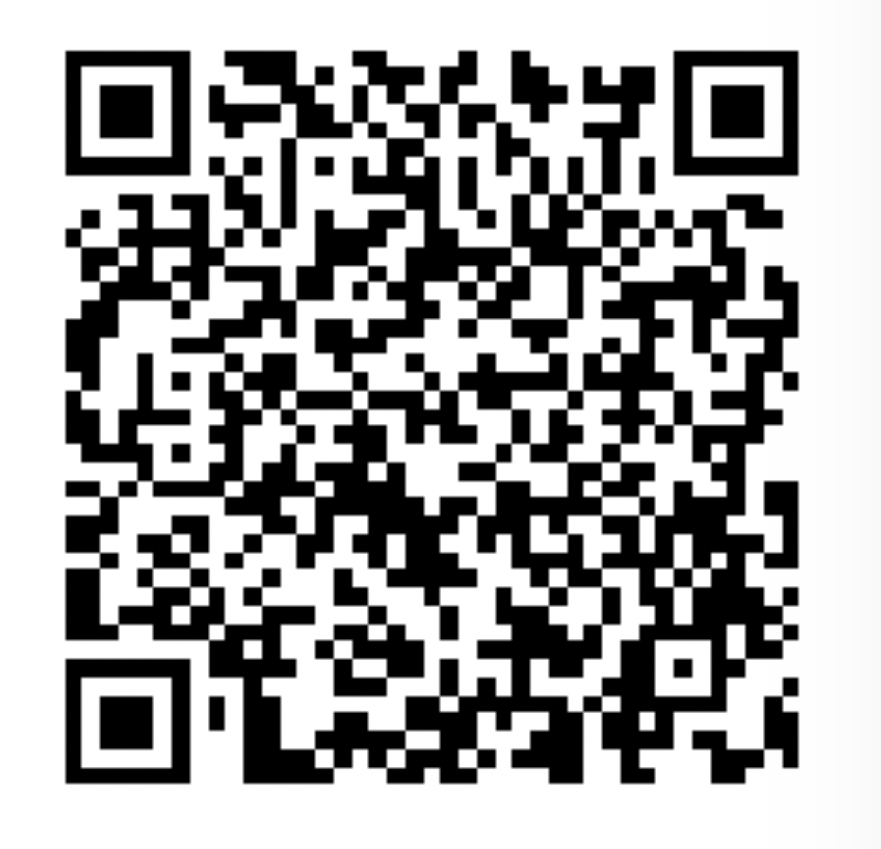

# Support

| Bitcoin | PayPal | Monzo | Revolut |
| :-------------: | :-------------: | :-------------: | :-------------: |
|  [Paypal](https://www.paypal.com/donate/?hosted_button_id=LWJUEGVUL4V5E) | [Monzo](https://monzo.me/yuliyanyordanov/5.00) | [Revolut](https://revolut.me/yyuhd) |

&nbsp;

- [Usage](#usage)
- [Lists](#lists)
- [License](#license)

&nbsp;

# Usage:

These converted files can be used with various DNS and domain-blocking tools:

## Using with [Pi-hole](https://pi-hole.net/):

1. Copy the link to the Pi-hole format for the desired list (from the appropriate table below).
2. Add the URL to your Pi-hole's block lists (**Login** > **Group Management** > **Adlists** > **Paste list URL in "Address" field, add comment** > **Click "Add"**)
3. Update Gravity (**Tools** > **Update Gravity** > **Click "Update"** )

## Using with GasMask:

1. Use the lists from the GasMask folder
2. Copy the contents of each list into a local list
3. Or add the raw list link as remote list

&nbsp;

# Lists:

## Main Lists

| List | Link | Description | Notes |
|--|--|--| -- |
| All-in-1 ads for PiHole| [GitHub Pages Link](https://raw.githubusercontent.com/jukatax/Lists/refs/heads/master/yy_all_ads.txt) | 23MB Lists of sites created to serve ads ||
| All-in-1 1of2 ads for PiHole| [GitHub Pages Link](https://raw.githubusercontent.com/jukatax/Lists/refs/heads/master/yy_all_ads_1_a-p.txt) | 11MB part 1 of 2 of the above main ads list ||
| All-in-1 2of2 ads for PiHole| [GitHub Pages Link](https://raw.githubusercontent.com/jukatax/Lists/refs/heads/master/yy_all_ads_2_q-z.txt) | 12MB part 2 of 2 of the main ads list  ||
| Abuse| [GitHub Pages Link](https://raw.githubusercontent.com/jukatax/Lists/refs/heads/master/GasMask/abuse.txt) | Lists of sites created to deceive |blocklistproject https://paypal.me/blocklistproject|
| Ads| [GitHub Pages Link](https://raw.githubusercontent.com/jukatax/Lists/refs/heads/master/GasMask/ads.txt) | Ad servers/sites |blocklistproject https://paypal.me/blocklistproject|
| Crypto| [GitHub Pages Link](https://raw.githubusercontent.com/jukatax/Lists/refs/heads/master/GasMask/crypto.txt) | Crypto/cryptojacking based sites   Can break normal "good" crypto sites |blocklistproject https://paypal.me/blocklistproject|
| Drugs| [GitHub Pages Link](https://raw.githubusercontent.com/jukatax/Lists/refs/heads/master/GasMask/drugs.txt) | RE sites that deal with illegal drugs  Including RX drugs illegal to posses in the US |blocklistproject https://paypal.me/blocklistproject|
| Facebook| [GitHub Pages Link](https://raw.githubusercontent.com/jukatax/Lists/refs/heads/master/GasMask/facebook.txt) | Block FB and FB relate/owned services |blocklistproject https://paypal.me/blocklistproject|
| Fraud| [GitHub Pages Link](https://raw.githubusercontent.com/jukatax/Lists/refs/heads/master/GasMask/fraud.txt) | Sites create to fraud |blocklistproject https://paypal.me/blocklistproject|
| Gambling| [GitHub Pages Link](https://raw.githubusercontent.com/jukatax/Lists/refs/heads/master/GasMask/gambling.txt) | All gambling based site legit and illegal |blocklistproject https://paypal.me/blocklistproject|
| Malware| [GitHub Pages Link](https://raw.githubusercontent.com/jukatax/Lists/refs/heads/master/GasMask/malware.txt) | Known sites that host malware |blocklistproject https://paypal.me/blocklistproject|
| Phishing| [GitHub Pages Link](https://raw.githubusercontent.com/jukatax/Lists/refs/heads/master/GasMask/phishing.txt) | Sites created to phish info |blocklistproject https://paypal.me/blocklistproject|
| Piracy| [GitHub Pages Link](https://raw.githubusercontent.com/jukatax/Lists/refs/heads/master/GasMask/piracy.txt) | Knows sites that allow for illegal downloads |blocklistproject https://paypal.me/blocklistproject|
| Porn| [GitHub Pages Link](https://raw.githubusercontent.com/jukatax/Lists/refs/heads/master/GasMask/porn.txt) | Porn or sites that promote porn |blocklistproject https://paypal.me/blocklistproject|
| Ransomware| [GitHub Pages Link](https://raw.githubusercontent.com/jukatax/Lists/refs/heads/master/GasMask/ransomware.txt) | Known sites that host or contain ransomware |blocklistproject https://paypal.me/blocklistproject|
| Redirect| [GitHub Pages Link](https://raw.githubusercontent.com/jukatax/Lists/refs/heads/master/GasMask/redirect.txt) | Sites that redirect your from your intended site |blocklistproject https://paypal.me/blocklistproject|
| Scam| [GitHub Pages Link](https://raw.githubusercontent.com/jukatax/Lists/refs/heads/master/GasMask/scam.txt) | Sites that intend to scam |blocklistproject https://paypal.me/blocklistproject|
| TikTok| [GitHub Pages Link](https://raw.githubusercontent.com/jukatax/Lists/refs/heads/master/GasMask/tiktok.txt) | Copy and pasted into your device |blocklistproject https://paypal.me/blocklistproject|
| Torrent| [GitHub Pages Link](https://raw.githubusercontent.com/jukatax/Lists/refs/heads/master/GasMask/torrent.txt) | Torrent directory   Will likely block legit torrent sites used for legal software download |blocklistproject https://paypal.me/blocklistproject|
| Tracking| [GitHub Pages Link](https://raw.githubusercontent.com/jukatax/Lists/refs/heads/master/GasMask/tracking.txt) | Sites dedicated to tracking and gathering visitor info |blocklistproject https://paypal.me/blocklistproject|
| Smart TV| [GitHub Pages Link](https://raw.githubusercontent.com/jukatax/Lists/refs/heads/master/GasMask/smart-tv.txt) | Smart TV call home and ads |blocklistproject https://paypal.me/blocklistproject|

# License:

For more details, see the [LICENSE](https://github.com/jukatax/Lists/blob/master/LICENSE) file.

&nbsp;

These files are provided "AS IS", without warranty of any kind, express or implied, including but not limited to the warranties of merchantability, fitness for a particular purpose and noninfringement. In no event shall the authors or copyright holders be liable for any claim, damages or other liability, arising from, out of or in connection with the files or the use of the files.

Any and all trademarks are the property of their respective owners.
